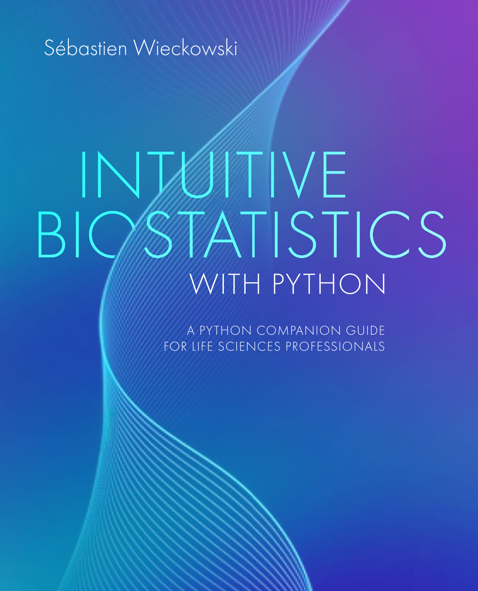

<div align="center">

# Intuitive Biostatistics with Python

**Official Companion Code, Datasets, and Reader Community**

[](https://www.python.org/)
[](https://github.com/sbwiecko/intuitive-biostatistics-python/discussions)
[](https://github.com/sbwiecko/intuitive-biostatistics-python/issues)
[](https://github.com/sbwiecko/intuitive-biostatistics-python/pulls)
[](./LICENSE)
[](https://mybinder.org/v2/gh/sbwiecko/intuitive-biostatistics-python/HEAD)

<br/>

<a href="https://global.oup.com/academic/product/intuitive-biostatistics-with-python-9780197845028">
  
</a>

<p>
  📚 <b><a href="https://global.oup.com/academic/product/intuitive-biostatistics-with-python-9780197845028">Get the Book on Oxford University Press</a></b> • 
  💬 <b><a href="https://github.com/sbwiecko/intuitive-biostatistics-python/discussions">Join the Reader Community</a></b>
</p>

</div>

---

## 📖 A Note to the Reader (Preface)

While you can clone this repository and run the scripts directly, **I highly recommend typing the code out yourself as you read.** The best way to build an intuitive understanding of biostatistics is through hands-on experimentation. 

Use this repository as a safety net to check your work, but do not hesitate to break the code, modify parameters, and most importantly, apply these scripts to your own unique datasets!

---

## 📑 Interactive Notebook Directory

All Jupyter Notebooks correspond directly to the book chapters and can be browsed directly on GitHub or run locally:

| Chapter | Topic | Notebook |
| :---: | :--- | :--- |
| **01** | Quantifying scatter of continuous data | [`01_quantifying_scatter_continuous_data.ipynb`](./01_quantifying_scatter_continuous_data.ipynb) |
| **02** | Gaussian distribution | [`02_gaussian_distribution.ipynb`](./02_gaussian_distribution.ipynb) |
| **03** | Confidence interval of a mean | [`03_confidence_interval_mean.ipynb`](./03_confidence_interval_mean.ipynb) |
| **04** | Confidence interval of a proportion | [`04_confidence_interval_proportion.ipynb`](./04_confidence_interval_proportion.ipynb) |
| **05** | Confidence interval of survival data | [`05_confidence_interval_survival_data.ipynb`](./05_confidence_interval_survival_data.ipynb) |
| **06** | Confidence interval of counted data | [`06_confidence_interval_counted_data.ipynb`](./06_confidence_interval_counted_data.ipynb) |
| **07** | Statistical significance | [`07_statistical_significance.ipynb`](./07_statistical_significance.ipynb) |
| **08** | Statistical power and sample size | [`08_statistical_power_sample_size.ipynb`](./08_statistical_power_sample_size.ipynb) |
| **09** | Normality tests and outliers | [`09_normality_tests_outliers.ipynb`](./09_normality_tests_outliers.ipynb) |
| **10** | Comparing proportions | [`10_comparing_proportions.ipynb`](./10_comparing_proportions.ipynb) |
| **11** | Comparing survival curves | [`11_comparing_survival_curves.ipynb`](./11_comparing_survival_curves.ipynb) |
| **12** | Comparing two unpaired means | [`12_comparing_two_unpaired_means.ipynb`](./12_comparing_two_unpaired_means.ipynb) |
| **13** | Comparing paired data | [`13_comparing_paired_data.ipynb`](./13_comparing_paired_data.ipynb) |
| **14** | Correlation | [`14_correlation.ipynb`](./14_correlation.ipynb) |
| **15** | Simple linear regression | [`15_simple_linear_regression.ipynb`](./15_simple_linear_regression.ipynb) |
| **16** | Comparing models | [`16_comparing_models.ipynb`](./16_comparing_models.ipynb) |
| **17** | Nonlinear regression | [`17_nonlinear_regression.ipynb`](./17_nonlinear_regression.ipynb) |
| **18** | Multiple regression | [`18_multiple_regression.ipynb`](./18_multiple_regression.ipynb) |
| **19** | Logistic regression | [`19_logistic_regression.ipynb`](./19_logistic_regression.ipynb) |
| **20** | ANOVA | [`20_anova.ipynb`](./20_anova.ipynb) |
| **21** | Meta-analysis | [`21_meta_analysis.ipynb`](./21_meta_analysis.ipynb) |
| **App. A** | Analysis of an *ex vivo* experiment | [`A_analysis_ex_vivo_experiment.ipynb`](./A_analysis_ex_vivo_experiment.ipynb) |

---

## 🧬 Datasets

The [`data/`](./data) directory contains all raw data files used across the analyses:

* `animals.csv` — Animal measurement data
* `cytometry.csv` — Flow cytometry experimental data
* `data_final.csv` — Compiled clinical and experimental cohort data
* `ifng_data.csv` — Interferon-gamma (IFN-γ) assay measurements
* `smp2.csv` & `Pr_sentation_variables__tude_SMP_MOOC_R.pdf` — "Santé Mentale en Prison (SMP)" study dataset and clinical variable documentation

---

## 💻 Installation & Running the Code

### Option 1: Run Locally

Requires **Python 3.12** installed on your system.

**1. Clone the repository:**

```bash
git clone https://github.com/sbwiecko/intuitive-biostatistics-python.git
cd intuitive-biostatistics-python
```

**2. Create and activate a virtual environment:**

```bash
python -m venv venv

# On Windows (PowerShell):
venv\Scripts\Activate.ps1

# On macOS/Linux:
source venv/bin/activate
```

**3. Install required dependencies:**

```bash
pip install -r requirements.txt
```

**4. Launch Jupyter Notebook or JupyterLab:**

```bash
jupyter notebook
# or: jupyter lab
```

### Option 2: Run in the Cloud (No Installation Required)

Click the **Launch Binder** badge below to run the notebooks in an interactive Jupyter environment in your browser:

[](https://mybinder.org/v2/gh/sbwiecko/intuitive-biostatistics-python/HEAD)

---

## 💬 Community, Q&A, and Errata

This repository serves as an open forum for readers:

* **🙋 Questions & Discussions:**  
  Use **[GitHub Discussions](https://github.com/sbwiecko/intuitive-biostatistics-python/discussions)** to ask conceptual questions about the book, discuss statistical interpretations, or share how you applied the code to your lab's data.
* **🐛 Errata & Code Bugs:**  
  Found a typo in a notebook, an outdated dependency, or an erratum? Please open an **[Issue](https://github.com/sbwiecko/intuitive-biostatistics-python/issues)** specifying the chapter and notebook affected.
* **🤝 Pull Requests:**  
  Community contributions and typos fixes are welcome! Feel free to open a **[Pull Request](https://github.com/sbwiecko/intuitive-biostatistics-python/pulls)** for code corrections, comments clarity, or dependency compatibility updates.

---

## 📚 Get the Book

If you are following along with this code and would like the complete theoretical background, worked biological contexts, and conceptual foundations:

👉 **[Buy "Intuitive Biostatistics with Python" on Oxford University Press](https://global.oup.com/academic/product/intuitive-biostatistics-with-python-9780197845035)**

---

## 📄 License & Copyright

* **Code & Notebooks:** All Python scripts and Jupyter Notebooks (`*.ipynb`) in this repository are released under the [MIT License](./LICENSE). You are free to use, modify, and distribute the code for academic, scientific, and commercial purposes.
* **Book Content & Cover:** The book cover (`cover.png`), explanatory prose, and pedagogical materials from *Intuitive Biostatistics with Python* are copyrighted by Oxford University Press. All rights reserved.
* **Datasets:** The sample datasets in [`data/`](./data) are provided for educational and reproducibility purposes alongside the text; any third-party clinical or study datasets remain subject to their respective original sources and terms of use.